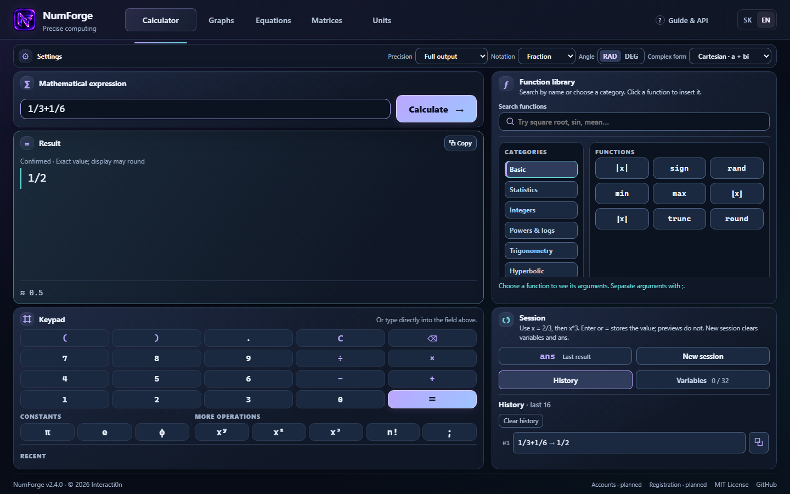
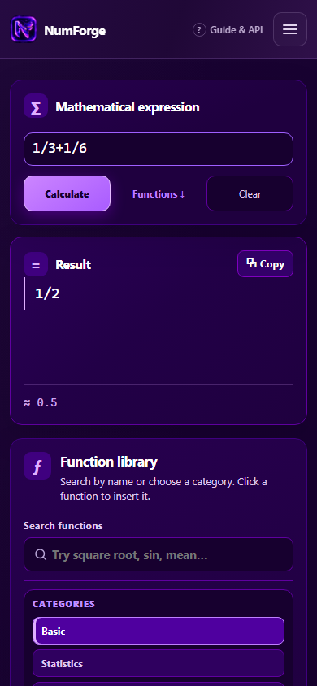

# NumForge


**Exact arithmetic. High-precision mathematics. One C17 core.**

[](https://github.com/Interacti0n/NumForge/actions/workflows/ci.yml)
[](https://github.com/Interacti0n/NumForge/releases/latest)
[](LICENSE)

NumForge is a modular mathematics library with optional CLI and Slovak/English
browser applications. Mathematical operations run in C and can be used without
a web interface, application session or database.

**Current source:** opaque integer, decimal, rational and complex types; a public
expression engine; exact polynomial and matrix operations; rational statistics
with covariance/regression; units; and bounded numerical grids, root searches and
finite-interval integration. An experimental
Python adapter calls the same C implementation. See the [supported API](docs/API.md).

**Published 2.4.0 downloads** predate the public engine, newer modules and Python
adapter. Use the matching release documentation for those archives. Python is
currently source-built and has not been published to PyPI.

[Get started](#get-started) · [Browser](#in-the-browser) · [C/C++ SDK](#cc-sdk) ·
[Python](docs/guides/PYTHON.md) · [Documentation](docs/README.md)

## NumForge in 15 seconds

| Calculator expression | Result |
| --- | --- |
| `0.1 + 0.2` | `0.3`, exact |
| `2^128` | `340282366920938463463374607431768211456` |
| `1/3 + 1/6` | `1/2`, exact reduced fraction |
| `sqrt(4/9)` | `2/3`, exact rational root |
| `convert(90; "km/h"; "m/s")` | `25` |
| `qty(5; "m") * qty(5; "m")` | `25 m²` |

Select Full precision with Plain or Fraction notation for exact results.
For an irrational result, select Plain and 40 output places:

```text
sqrt(2) ≈ 1.4142135623730950488016887242096980785697
```

Exact arithmetic stays exact within resource limits. Approximate functions use
explicit working precision; this is not a universal error guarantee for composed
expressions. Graph sampling and numerical root discovery are bounded and can
miss features or roots.

## In the browser

The local application provides a calculator, converter, four-function graphs,
equation solving and session variables/history. Arithmetic runs in C; JavaScript
handles presentation and requests. No Node.js, Python or database is needed at runtime.



<details>
<summary>Mobile view</summary>



</details>

These development screenshots were captured during 2.1 preparation; they show
the calculator workflow, not every control in the current source.

## Get started

Download a portable application from the
[release page](https://github.com/Interacti0n/NumForge/releases/latest), verify its
matching SHA-256 and extract the whole archive. Platform/runtime details are in
[release packaging](docs/project/RELEASE_PACKAGING.md).

To use the shared build profiles, install CMake 3.21+ and a C17 compiler:

```sh
git clone https://github.com/Interacti0n/NumForge.git
cd NumForge
cmake -S . -B build -DCMAKE_BUILD_TYPE=Release -DBUILD_TESTING=OFF
cmake --build build --config Release
```

Run `numforge_web` and `calculator` from `build/`, or `build/Release/` with
Visual Studio. The web app listens on loopback port 8765. Use `--port N` for
another port and `--no-browser` to suppress browser launching. For remote access,
read the [hosting guide](docs/guides/HOSTING.md); concurrent server readiness is
a separate [roadmap milestone](docs/project/ROADMAP.md).

## C/C++ SDK

Link the standalone numeric target from an installed library or compatible SDK:

```cmake
find_package(NumForge CONFIG REQUIRED)
target_link_libraries(my_target PRIVATE NumForge::numforge)
```

Set `CMAKE_PREFIX_PATH` to the installation/SDK prefix. The
[SDK quick start](docs/guides/SDK.md) covers prebuilt archives and toolchain
compatibility; the [library guide](docs/guides/LIBRARY_GUIDE.md) covers source
installation and a complete C example. Current source optionally exports
`NumForge::engine` for expressions. Installed public headers define the contracts.

## Architecture

| Location | Responsibility |
| --- | --- |
| `include/numforge/` | Installed C APIs |
| `src/core/`, `src/runtime/` | Numeric representations, arithmetic and resource scopes |
| `src/modules/` | Independently callable mathematical algorithms |
| `src/engine/` | Parsing, typed expression evaluation and formatting |
| `src/application/` | Sessions and application workflows |
| `bindings/`, `apps/` | Language adapters, CLI and web |
| `tests/`, `benchmarks/`, `docs/` | Verification, measurements and documentation |

Algorithms have one owner; interfaces reuse them. See the
[architecture rules](docs/design/ARCHITECTURE.md) and
[ordered roadmap](docs/project/ROADMAP.md) for boundaries and next work.

## Measured performance

Reproducible measurements, exact references and machine/compiler details live in
the [benchmark tools guide](benchmarks/README.md) and its linked reports.
Historical timings and private experiments are not current performance guarantees.

## Test

```sh
cmake -P cmake/LocalBuild.cmake
```

This builds Release and runs CTest. The first test configuration fetches Unity;
Node.js enables additional checks. Browser testing uses Playwright separately.
See [testing](docs/TESTING.md) for focused checks and package verification.

## Contributing

Start with [CONTRIBUTING.md](CONTRIBUTING.md) and the
[mathematical feature checklist](docs/project/FEATURE_CHECKLIST.md).
For a numerical issue, include input, precision, rounding, expected result and
its independent reference.

## Documentation

Use the [documentation guide](docs/README.md) to choose a workflow, API reference
or implementation topic. [Changelog](CHANGELOG.md) and [release verification](docs/project/RELEASES.md)
are separate from current usage instructions.

## License

[MIT](LICENSE). Copyright (c) 2026 Interacti0n.
