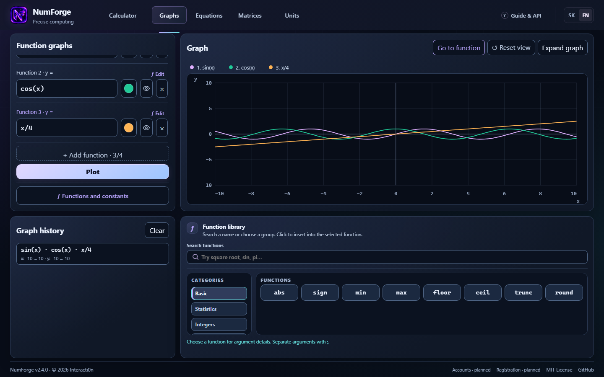
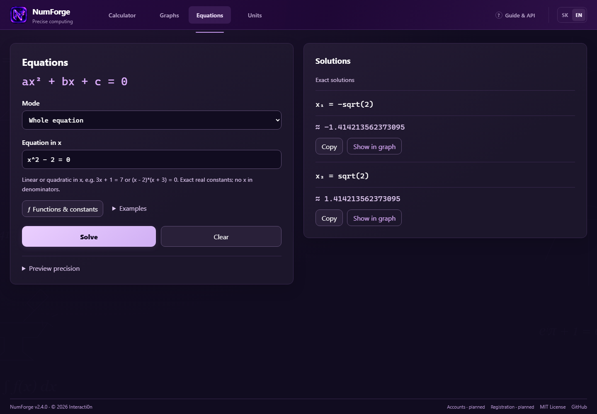

# NumForge


**Exact arithmetic. High-precision mathematics. One C17 core.**

[](https://github.com/Interacti0n/NumForge/actions/workflows/ci.yml)
[](https://github.com/Interacti0n/NumForge/releases/latest)
[](LICENSE)

NumForge is a modular mathematics platform: a standalone C library, an expression
engine, an experimental Python adapter, and CLI/browser applications.
The interfaces reuse C implementations; mathematical operations work without a
browser, application session or database.

[Get started](#get-started) · [Browser](#in-the-browser) · [C/C++](#cc-sdk) ·
[Python](#python) · [Documentation](docs/README.md) · [Roadmap](docs/project/ROADMAP.md)

## What can it do?

| Capability in current source | Explore |
| --- | --- |
| Arbitrary-precision integers, decimals, fractions and complex numbers | [Numeric APIs](docs/reference/C_API.md) |
| Typed expressions, explicit precision and reusable parameterized expressions | [Expression engine](docs/reference/ENGINE_API.md) |
| Exact linear/quadratic equations, rational matrices and general linear systems | [Supported APIs](docs/API.md) |
| Exact statistics, covariance and linear regression | [Statistics](docs/reference/STATISTICS_API.md) |
| Exact grids, bounded root searches and approximate finite-interval integration | [Numerical methods](docs/reference/NUMERICAL_API.md) |
| Unit conversions and dimensional quantities | [Units](docs/reference/UNITS.md) |

C/Python expose mathematical APIs beyond the browser tools. See
[interface coverage](docs/reference/WEB_API_PARITY.md) for availability.

## NumForge in 15 seconds

| Calculator expression | Result |
| --- | --- |
| `0.1 + 0.2` | `0.3`, exact |
| `2^128` | `340282366920938463463374607431768211456` |
| `1/3 + 1/6` | `1/2`, exact reduced fraction |
| `sqrt(4/9)` | `2/3`, exact rational root |
| `convert(90; "km/h"; "m/s")` | `25` |
| `qty(5; "m") * qty(5; "m")` | `25 m²` |

Use Full precision and Plain or Fraction notation as appropriate for these
exact results. For `sqrt(2)`, choose Plain and 40 output places:

```text
1.4142135623730950488016887242096980785697
```

Exact arithmetic stays exact within resource limits. Approximate calculations
use explicit working precision; output places do not certify whole-expression
accuracy. Numerical root discovery and graph sampling can miss roots or features.

## In the browser

The Slovak/English application combines a scientific calculator, unit converter,
up to four function graphs, exact/numerical equation solving, variables and
confirmed history. Arithmetic runs in C; JavaScript handles presentation and
requests. No Node.js, Python or database is needed at runtime.


<details>
<summary>Graphs, equations and mobile view</summary>

<p></p>

<p></p>


</details>

Real application captures, refreshed on 21 October 2026 from development source.
Start with the [calculator guide](docs/guides/CALCULATOR_WEB.md),
[graphs](docs/guides/GRAPHS.md) or [equations](docs/guides/EQUATIONS.md).

## Get started

For the newest features, build current source with **CMake 3.21+** and a **C17 compiler**:

```sh
git clone https://github.com/Interacti0n/NumForge.git
cd NumForge
cmake --preset apps
cmake --build --preset apps
```

Run `numforge_web` or `calculator` from `build/apps/`, or `build/apps/Release/`
with Visual Studio. Open `http://127.0.0.1:8765` for the browser app.
Use `--port N` for another port and `--no-browser` to suppress browser launching.
Remote access, bounded workers and queue settings are covered by
[Hosting](docs/guides/HOSTING.md). Session capacity and sustained-load validation
remain in development.

Prefer a portable download? Get an application or SDK from
[Releases](https://github.com/Interacti0n/NumForge/releases/latest), verify its
SHA-256 and extract the whole archive. **Published 2.4.0 packages have an older
API than current source** and do not include Python. Check
[SDK compatibility](docs/guides/SDK.md) before choosing a binary.

## C/C++ SDK

The numeric library and optional expression engine can be installed independently
of the applications. Link the target your project needs:

```cmake
find_package(NumForge CONFIG REQUIRED)
target_link_libraries(my_target PRIVATE NumForge::numforge)
# Use NumForge::engine when you also need expression parsing and evaluation.
```

Follow [C/C++ from source](docs/guides/LIBRARY_GUIDE.md) for installation and a
complete C example, or the [prebuilt SDK guide](docs/guides/SDK.md) for archives.
Installed headers define that package's API and ownership rules.

## Python

The experimental adapter is source-built with CPython 3.10+, its development
headers, CMake and a C17 toolchain. In a virtual environment, from this checkout:

```sh
python -m pip install .
```

```python
from fractions import Fraction
import numforge as nf

assert nf.evaluate("1/3+1/6").as_fraction() == Fraction(1, 2)
assert nf.Matrix([[1, 2], [3, 4]]).determinant() == -2

fit = nf.linear_regression([1, 2, 3], [1, 2, 2])
assert (fit.slope, fit.intercept) == (Fraction(1, 2), Fraction(2, 3))

root = nf.sqrt(2, precision=1000)   # 1000 working digits; approximate
assert not root.exact

area = nf.integrate(lambda x, places: x*x, 0, 1)
assert area.kind == "estimated" and area.value == Fraction(1, 3)
assert not area.exact              # Numerical integration remains approximate.
```

These operations call the C implementation. See [Python](docs/guides/PYTHON.md)
for prepared expressions, root searches, budgets and supported input types.
The adapter is **not published to PyPI**; `pip install numforge` is not the
installation command for this project.

## Architecture

The numeric core and modules own mathematical algorithms; the engine adds parsing
and typed expression evaluation. Application state, HTTP and language adapters
live in separate layers. See [Architecture](docs/design/ARCHITECTURE.md) for the
source map and [Roadmap](docs/project/ROADMAP.md) for the ordered next steps.

## Measured performance

[Benchmark tools](benchmarks/README.md) and [selected measurements](docs/performance/README.md)
include environments, verification and limits. Recorded timings describe their
revision and machine; they are not current performance or server-capacity guarantees.

## Test

```sh
cmake --preset dev
cmake --build --preset dev
ctest --preset dev
```

The first test configuration fetches Unity. Node.js enables additional checks;
Playwright tests run separately. See [Testing](docs/TESTING.md) for focused checks,
Python packages and installed C/C++ consumers.

## Contributing

Start with [Contributing](CONTRIBUTING.md) and the
[feature checklist](docs/project/FEATURE_CHECKLIST.md). For a numerical issue,
include input, precision, rounding, expected result and its independent reference.

## Documentation

[Start here](docs/README.md) for user guides and integration paths.
[Changelog](CHANGELOG.md) records user-visible changes;
[release verification](docs/project/RELEASES.md) records published artifact checks.

## License

[MIT](LICENSE). Copyright (c) 2026 Interacti0n.
