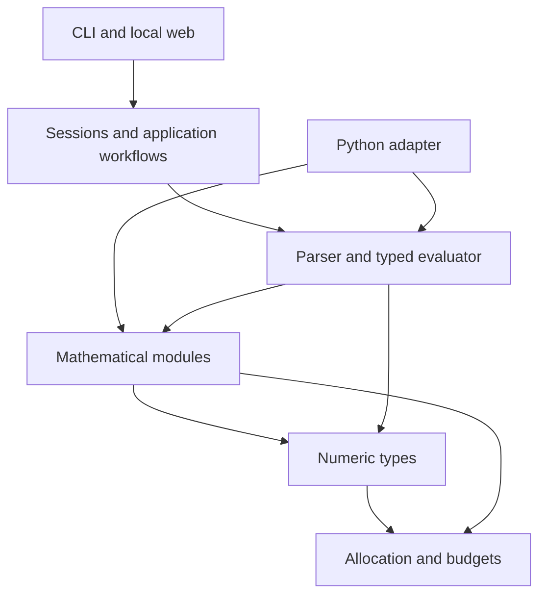

# Architecture and extension boundaries

NumForge is a modular mathematics platform built on one C17 implementation.
Typed mathematical operations work independently of expression parsing, sessions
and the web. Only declarations in installed `include/numforge/` headers are public
contracts; private symbols in a static archive are not supported APIs.

## Source ownership

| Location | Responsibility |
| --- | --- |
| `src/runtime/` | Allocation, cooperative budgets and opt-in instrumentation. |
| `src/core/` | BigInt, BigDecimal, BigRational and complex representations and arithmetic. |
| `src/modules/` | Independently callable mathematical capabilities; each module owns a CMake manifest. |
| `src/engine/api/` | Public expression context, prepared handles, typed results and compatibility calculator entry points. |
| `src/engine/parser/` | Tokenizer and expression AST. |
| `src/engine/evaluator/` | Shared typed evaluation, functions and constants. |
| `src/engine/values/`, `formatting/` | Owned values, quantities and numerical formatting. |
| `src/application/` | Sessions, clients, conversions, prepared graph expressions and equation adapters. |
| `apps/cli/` | Interactive command line. |
| `apps/web/http/`, `server/`, `assets/` | Local transport, embedded server and SK/EN browser interface. |
| `bindings/python/` | Experimental CPython facade, native module/support and numerical adapters over public C APIs; explicit CMake manifest. |
| `include/numforge/` | Installed C API and authoritative ownership/error contracts. |
| `tests/`, `benchmarks/`, `examples/` | Regressions, opt-in measurements and consumer examples. |

The Python extension keeps module registration and scalar/expression entry points
in `native.c`. `polynomial.c`, `matrix.c` and `statistics.c` own their domain
adapters; `numerical.c` owns grid/root callbacks. `native_support.c` shares policy,
status, exact-value conversion and scalar-result capsule ownership. Domain-specific
handles and borrowed matrix views stay with their owning adapter. Their
`native_internal.h` is private to the binding. Add native sources explicitly in
`bindings/python/CMakeLists.txt`; the source package includes that manifest and
private header. The installed module and Python API remain one interface, with no
dependency on private core/engine implementation headers.

## Dependencies

Lower layers never depend on applications, transport or bindings. Modules may
reuse core types and other mathematical modules; avoid cyclic ownership. Parser
dispatch and adapters call the same implementation rather than copying algorithms.
Public engine handles conceal AST/value details. Sessions and graph-specific
snapshots remain private application state; the initial public engine subset does
not redefine established calculator behavior.

`NumForge::numforge` contains runtime, core and mathematical modules.
`NumForge::engine` adds stateless expression evaluation. Private application and
HTTP targets compose them; CLI links the application directly. Numeric-only,
engine-only and Python builds remain possible. A source module does not require a
separate shared library or a runtime plugin framework.

Private includes use repository-qualified paths. CMake exposes the repository
root privately, while installed consumers see only public headers.
`scripts/check_architecture.cjs`, also registered in CTest when Node is available,
checks upward source includes, private leaks in public headers and source
manifests for all existing implementation layers. Bare private-header includes,
unowned C files and missing registered files are rejected; comments cannot
register sources. Module-private headers are restricted to their owning module; application
formatting and HTTP serialization use public getters for opaque results. The
equation research adapter may include the private strategy callback contract,
which exposes no result storage. Opt-in decimal profiling has one explicit
core-inspection exception.
CLI/HTTP code uses private engine/application API contracts and function catalogue
metadata, without parser, evaluator-storage, value-internal or formatter headers.
Numeric status conversion is centralized in `src/engine/api/status.h`; it does
not require evaluator storage or function dispatch declarations. Established
decimal error policies remain distinct for compatibility.
Core storage headers stay within the core, apart from the existing decimal
profiler. The exact rational square-root helper has two named consumers: the
polynomial solver and exact expression evaluator; it exposes no numeric storage.
This source check complements compilation and consumer tests; it does not prove
the absence of every indirect or link-time dependency.

## Mathematical ownership

| Module | Responsibility | Current foundation / next boundary |
| --- | --- | --- |
| Core / Arithmetic | Numeric representations, elementary arithmetic and conversions | Public BigInt, BigDecimal, BigRational and complex APIs |
| Number Theory | Primality, factors, congruences and modular arithmetic | Selected public BigInt operations; broaden with individual contracts |
| Algebra | Polynomials, algebraic equations and exact root representations | Public exact linear/quadratic coefficient solver in the numeric target; application parsing/preview adapters remain private |
| Linear Algebra | Vectors, matrices, decompositions and linear systems | Public immutable dense rational matrices, products/determinants, rank and complete rectangular single-RHS families; approximate/complex domains and broader decompositions remain future |
| Calculus / Analysis | Mathematical concepts and user-facing organization | Symbolic and numerical algorithms have separate owners below |
| Numerical | Sampling, root finding, interpolation, quadrature, ODEs and optimization | Public exact grids, adaptive scheduling/curve acceptance, phase anchors, bisection and bounded root scanning; expression/domain adapters and Brent/hybrid research remain private |
| Statistics | Datasets, aggregates, distributions, regression and tests | Public exact rational batch summaries and paired covariance plus existing decimal scalar aggregates; regression, streaming and distribution contracts remain future |
| Symbolic | Symbolic expression representation, assumptions and rewrites | Future; calculator AST is not automatically a public CAS representation |
| Scientific | Units, quantities, sourced constants and domain models | Public units and private quantity expressions; broader models remain future |

Numerical integration belongs to Numerical and symbolic integration to Symbolic;
both can appear under Calculus in the product. Linear systems belong to Linear
Algebra. Shared operations have one owner, even when documented in several topics.

## Common contracts

**Precision.** Distinguish working significant digits, decimal scale, display
digits and a proven error bound. Never reinterpret an existing numeric API's
scale parameter as significant digits. Working precision cannot promise the same
final accuracy after arbitrary cancellation or poorly conditioned composition.
Integer/rational arithmetic remains exact rather than rounding to a digit budget.

**Results.** Preserve typed values independently of formatted strings. Exactness
means a proven property of the computation, not simply a decimal/integer label or
cache independence. A conservative approximate classification may include a value
that happens to be mathematically exact. Certified enclosures require separate
evidence; a residual alone is not a certified root error bound.

**Failures.** Document domains, branch choices, ownership, output/input aliasing,
unchanged-output-on-failure behavior and resource exhaustion. Solver nonconvergence
and incomplete discovery are numerical outcomes, not claims that solutions do not
exist. Existing public numeric status enums remain supported; engine statuses map
them without forcing a project-wide rename.

**Runtime.** Context policy is per operation, not mutable global state. Prepared
expressions are reusable independently of the context that prepared them. A
compound operation shares one cooperative budget. Nested operations reuse an
existing scope and never reset its counters or end a caller-owned scope. Limits
are not hard process isolation. Thread-confined handles can be used independently
on separate threads; sharing requires caller synchronization.

**Adapters.** Preserve large integers and decimal inputs losslessly. Python
and future JSON adapters must not pass exact decimal input through a binary floating
point conversion. Version transport schemas separately from internal structures.
An adapter's availability is explicit; supporting a new C operation does not
require implementing every future language binding in the same change.

## Concurrent server prerequisites

The loopback server has a fixed worker pool and a bounded FIFO connection queue.
This ownership audit is not a measured capacity guarantee; operating limits live
in [Hosting](../guides/HOSTING.md#capacity-and-state).

| State | Current ownership | Rule / remaining work |
| --- | --- | --- |
| HTTP client store | One static `ApplicationClientStore`; eight slots per pool, synchronized read/exclusive reservations | Bound session bytes/count/lifetime. |
| Session values/revisions/RNG | Shared immutable reads, exclusive mutations/cache access and bounded FIFO conflict queues | Preserve revision/retry semantics when extending handlers. |
| Random seed fallback | Thread-local sequence in `random.c`, updated when OS entropy fails | Keep each session's mutable generator state under its exclusive reservation; fallback is not cryptographic entropy. |
| Runtime budgets | Scopes begin/end in the executing worker | Never transfer an active scope between threads. |
| Instrumentation | Live-allocation tracking stays disabled in web workers; failure injection is inactive in the server | Use OS process memory for load diagnostics; current thread-local ledgers cannot measure cross-worker frees. Run fault injection in isolated fixtures. |

`ApplicationClientLease` is a private, zero-initialized, non-copyable reservation.
Nonblocking acquisition returns SESSION_BUSY on conflict; HTTP adapters use the
bounded waiting variant. Creation skips held/queued slots and fails unchanged if
no replacement is available. Store destruction refuses leases and waiters. Serial setup helpers
remain for internal fixtures and require excluding concurrent access, but HTTP
paths use leases. One process-wide OS mutex (Windows SRW lock/POSIX mutex)
protects acquisition, release and destruction across zero-initialized stores.
Calculation and serialization run outside that lock. READ leases expose only a
const session, permit concurrent readers and block mutation/eviction/destruction
until the last reader releases. Each lease belongs to one thread; cache access
remains exclusive. Replacement/destruction cleanup still runs under the metadata
lock.

Existing-entry conflicts queue in FIFO order, with consecutive READs allowed to
share a phase; later readers cannot bypass a waiting writer. Limits are eight
waiters per entry and 32 per store across both pools. HTTP waits up to 250 ms,
separately from the calculation budget; full queues/timeouts return SESSION_BUSY
without changing data or revisions. An original monotonic deadline survives
unrelated notifications. Waiting nodes use caller stacks, pin their entries and
are removed on timeout or deferred POSIX cancellation. Shutdown must cooperate
with active owners. These guards do not provide hard real-time deadlines.
Contention, limits, replay and snapshot behavior are
covered by `client_scheduling_tests`, with optional live-allocation tracking
disabled because its thread-local ledgers cannot follow ownership transfers.

`web_main.c` owns admission and signal flags; `web_workers.c` owns fixed threads,
socket slots and queue expiry. The acceptor sweeps expired sockets even with all
workers occupied; rejection never waits on peer I/O. A worker owns a dequeued
socket through calculation, serialization and close, outside the queue lock.
Queue time consumes the original receive deadline. Shutdown stops admission,
discards queued sockets, joins active owners and destroys session state last.
The private backend target is shared with real-socket worker tests; mathematical
libraries do not depend on it. Live allocation tracking remains off because
retained session values can change worker owners. Public opaque handles still
require caller synchronization when shared. See the
[load protocol](../performance/protocols/APPLICATION.md#multi-client-load).

## Application behavior

Sessions own confirmed `ans`, variables, history and preview state. Exact values
remain typed through confirmation, caches and formatting. Prepared application
expressions snapshot referenced values and evaluate under one operation budget
without modifying their source session. Numerical interval workflows delegate to
the [public root-search and scan kernels](../reference/NUMERICAL_API.md); parsing,
domain analysis and HTTP serialization remain private application operations.
Uniform graph coordinates and adaptive seed coordinates use the public exact
grid walker. Precision graphs also share bounded breadth-first interval scheduling.
Their chord/phase/step acceptance and offscreen deferral share the public curve
classifier. Periodic-phase target selection and callback refinement use the public
phase locator; actual typed samples are inserted by the adapter. Typed sampling,
expression metadata extraction and angular-unit selection remain application-owned;
numeric rules do not inspect ASTs or sessions.

Some application-to-engine dependencies are deliberate: expression preparation,
domain analysis, fast-expression compilation and polynomial recognition inspect
the private AST; sessions use constant/function metadata and RNG state; conversion
validation uses the tokenizer; graph and fast-expression adapters materialize typed
values. The public scalar engine currently excludes sessions, degrees, quantities
and graph phase capture. Replacing these adapters with public handles requires
equivalent supported contracts first; moving includes alone would not remove that
semantic dependency. No public API expansion is required for private error mapping.

Fast graphs retain binary floating-point phase guards, dense envelopes and
Hermite/pixel acceptance in the application layer: these are approximate display
policies tied to the camera and expression metadata. Candidate verification also
retains its 16-digit coordinate keys, request-local sample cache, 24-step
refinement and residual/contact checks. It is not interchangeable with the public
bounded root solver or a completeness/certification contract. Shared decimal-to-double
projection belongs to the private graph adapter; exact rational differences and
original-expression checks happen before that lossy conversion. A future reusable
screen arithmetic API needs an explicit approximation and failure contract before
these rules move into the numeric library.

The browser handles input and presentation; C performs mathematical evaluation.
CMake embeds assets and the license in the local server, so installed applications
need no asset directory or Node runtime. The loopback server uses bounded requests
and in-memory sessions. Remote deployment requirements have a separate
[hosting guide](../guides/HOSTING.md).

See [application design](APPLICATION_DESIGN.md), [engine API](../reference/ENGINE_API.md),
[roadmap](../project/ROADMAP.md) and the [contributor guide](../../CONTRIBUTING.md).
