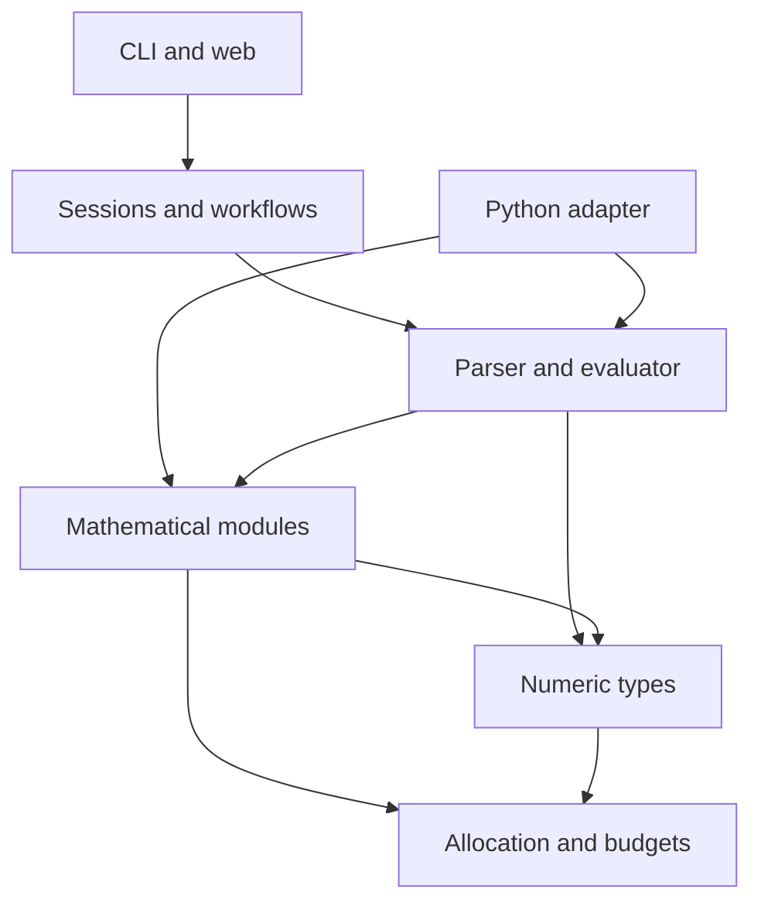

# Architecture and extension boundaries

One C17 implementation owns each mathematical operation. Installed
`include/numforge/` headers define public contracts; private archive symbols do not.

## Source ownership

| Location | Owns |
| --- | --- |
| `src/runtime/` | Allocation, cooperative budgets, opt-in instrumentation |
| `src/core/` | Integer, decimal, rational and complex representations/arithmetic |
| `src/modules/` | Independently callable mathematical modules and their source manifests |
| `src/engine/` | Public contexts/handles, parser, typed evaluator, values and formatting |
| `src/application/` | Sessions, client stores, conversions, graph/equation adapters |
| `apps/cli/`, `apps/web/` | CLI, HTTP/server and embedded SK/EN browser assets |
| `bindings/python/` | CPython adapters over public C APIs |
| `include/numforge/` | Installed declarations, ownership/error contracts |
| `tests/`, `benchmarks/`, `examples/` | Regressions, opt-in measurements, consumers |

Python's `native.c` registers scalar/expression calls; domain files own their
adapters and `native_support.c` shares policy/conversion/capsule ownership.
Binding sources are explicitly listed in `bindings/python/CMakeLists.txt`.

## Dependencies

`NumForge::numforge` contains runtime/core/modules; `NumForge::engine` adds
stateless expressions. Applications/HTTP targets stay private. Numeric-only,
engine and Python builds remain independent of the web. Modules need no runtime
plugin framework or separate shared library.

Lower layers never depend on apps/bindings. Private includes use repository
paths; installed consumers see public headers only. `check_architecture.cjs`
checks layering, header leaks and explicit source manifests. Module internals
stay with their owner; HTTP/formatters use opaque getters. Exceptions are the
decimal profiler, named rational-root consumers and private strategy callbacks;
none exposes numeric/result storage to applications. Footprint queries return
byte counts, not layouts. Status mapping lives in `src/engine/api/status.h`.

## Mathematical ownership

| Owner | Current foundation / future boundary |
| --- | --- |
| Core | BigInt, BigDecimal, BigRational, complex types |
| Number theory | Selected BigInt operations; broaden through individual contracts |
| Algebra | Exact linear/quadratic coefficient solver |
| Linear algebra | Rational matrices, rank, square solves and rectangular single-RHS families; other domains/decompositions are future |
| Numerical | Grids, sampling policies, phase anchors, roots/scans and finite-interval integration; ODE/optimization are future |
| Statistics | Exact summaries, covariance, linear regression; streaming/distributions are future |
| Symbolic | Future assumptions/rewrites; the calculator AST is not a public CAS |
| Scientific | Units and quantity expressions; broader models are future |

Calculus is a product grouping: numerical integration belongs to Numerical,
symbolic integration to Symbolic. Shared operations retain one owner.

## Common contracts

- Distinguish significant working digits, decimal scale, display places and
  proven error bounds. Existing scale parameters keep their meaning. Guard
  digits do not certify arbitrary composed calculations.
- Preserve typed exact/approximate values independently of display strings.
  Residuals and incomplete searches are not existence/completeness proofs.
- Document domains, branches, ownership, aliasing, threading and unchanged
  outputs on failure. Keep existing numeric status compatibility.
- Context is per operation. Compound/nested calls share one cooperative budget;
  never reset/end a caller-owned scope or transfer it between threads.
- Handles are thread-confined unless callers synchronize sharing. Budgets are
  not hard process isolation.
- Adapters preserve integer/decimal text without binary-float round trips.
  Version transport schemas separately. Expose only implemented adapters.

## Concurrent server prerequisites

The server has fixed workers and a bounded FIFO socket queue. Capacity evidence
and configuration belong to [Hosting](../guides/HOSTING.md#capacity-and-state).

`ApplicationClientLease` is zero-initialized, non-copyable and thread-owned.
READ leases share immutable sessions; mutation/cache access is exclusive.
Held/queued entries cannot be evicted or destroyed. A process-wide OS mutex
protects metadata; calculation/serialization run outside it. Cleanup during
replacement/destruction remains under the lock. Serial fixture helpers require
excluding concurrent access.

Conflicts queue FIFO; later readers cannot bypass waiting writers. Limits are
eight waiters per entry, 32 per store and 250 ms HTTP waiting, separate from
calculation time. Full queues/timeouts return SESSION_BUSY unchanged. Deadlines
are monotonic; stack waiters pin entries and are removed on timeout/deferred
POSIX cancellation. Shutdown cooperates with active owners.

Retention guards reserve prospective sizes atomically. Rejected writes preserve
values/revisions; clear/reset/expiry release quota. Runtime scopes begin/end on
the executing worker. Session RNG changes require its exclusive lease; seed
fallback is thread-local and non-cryptographic.

Thread-local live-allocation tracking is disabled in web workers because values
can be freed by another worker; fault injection stays in isolated tests. Use OS
memory diagnostics for load. Opt-in serial tracing is not a concurrent profile.

`web_main.c` owns admission/signals; `web_workers.c` owns threads/socket slots.
Queue waiting consumes the original receive deadline. Admission expiry/rejection
never waits for peer I/O; dequeued sockets belong to one worker through close.
Shutdown stops admission, discards queued sockets, joins workers, then destroys
state. Scheduling/policy/socket tests cover these boundaries.

## Application behavior

Sessions own ans, variables, history and previews. Prepared application handles
snapshot referenced typed values, context and source locations without mutating
sessions. Grids/root searches share public numeric kernels; AST/domain analysis,
typed sampling, angle selection and serialization remain private adapters.

Private engine dependencies are deliberate where adapters inspect ASTs, RNG,
quantities or domain metadata absent from the public scalar engine. Moving an
include does not remove that semantic dependency; public handles need equivalent
contracts before replacing it.

Screen phase guards, dense envelopes, Hermite/pixel acceptance and graph marker
verification remain approximate camera-dependent application policies, distinct
from public root kernels. Exact differences/original-expression checks precede
lossy decimal-to-double projection. See [graph contracts](../API.md).

The browser owns presentation; C owns mathematics. Assets/license are embedded,
so portable apps need no Node runtime. [Application design](APPLICATION_DESIGN.md)
owns session/persistence boundaries; [Testing](../TESTING.md) owns verification.
