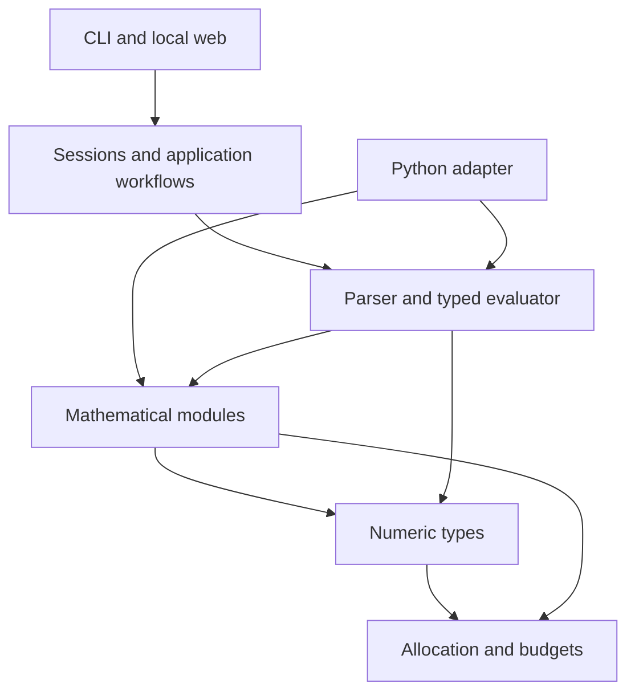

# Architecture and extension boundaries

NumForge is a modular mathematics platform built on one C17 implementation.
Typed mathematical operations work independently of expression parsing, sessions
and the web. Only declarations in installed `include/numforge/` headers are public
contracts; private symbols in a static archive are not supported APIs.

## Source ownership

| Location | Responsibility |
| --- | --- |
| `src/runtime/` | Allocation, cooperative budgets and opt-in instrumentation. |
| `src/core/` | BigInt, BigDecimal, BigRational and complex representations and arithmetic. |
| `src/modules/` | Independently callable mathematical capabilities; each module owns a CMake manifest. |
| `src/engine/api/` | Public expression context, prepared handles, typed results and compatibility calculator entry points. |
| `src/engine/parser/` | Tokenizer and expression AST. |
| `src/engine/evaluator/` | Shared typed evaluation, functions and constants. |
| `src/engine/values/`, `formatting/` | Owned values, quantities and numerical formatting. |
| `src/application/` | Sessions, clients, conversions, prepared graph expressions and equation adapters. |
| `apps/cli/` | Interactive command line. |
| `apps/web/http/`, `server/`, `assets/` | Local transport, embedded server and SK/EN browser interface. |
| `bindings/python/` | Experimental source-built CPython adapter over public C APIs. |
| `include/numforge/` | Installed C API and authoritative ownership/error contracts. |
| `tests/`, `benchmarks/`, `examples/` | Regressions, opt-in measurements and consumer examples. |

## Dependencies

Lower layers never depend on applications, transport or bindings. Modules may
reuse core types and other mathematical modules; avoid cyclic ownership. Parser
dispatch and adapters call the same implementation rather than copying algorithms.
Public engine handles conceal AST/value details. Sessions and graph-specific
snapshots remain private application state; the initial public engine subset does
not redefine established calculator behavior.

`NumForge::numforge` contains runtime, core and mathematical modules.
`NumForge::engine` adds stateless expression evaluation. Private application and
HTTP targets compose them; CLI links the application directly. Numeric-only,
engine-only and Python builds remain possible. A source module does not require a
separate shared library or a runtime plugin framework.

Private includes use repository-qualified paths. CMake exposes the repository
root privately, while installed consumers see only public headers.
`scripts/check_architecture.cjs`, also registered in CTest when Node is available,
checks upward source includes, private leaks in public headers and module source
manifests. Opt-in decimal profiling has one explicit core-inspection exception.
This source check complements compilation and consumer tests; it does not prove
the absence of every indirect or link-time dependency.

## Mathematical ownership

| Module | Responsibility | Current foundation / next boundary |
| --- | --- | --- |
| Core / Arithmetic | Numeric representations, elementary arithmetic and conversions | Public BigInt, BigDecimal, BigRational and complex APIs |
| Number Theory | Primality, factors, congruences and modular arithmetic | Selected public BigInt operations; broaden with individual contracts |
| Algebra | Polynomials, algebraic equations and exact root representations | Public exact linear/quadratic coefficient solver in the numeric target; application parsing/preview adapters remain private |
| Linear Algebra | Vectors, matrices, decompositions and linear systems | Public immutable dense rational matrices, products/determinants, rank and complete rectangular single-RHS families; approximate/complex domains and broader decompositions remain future |
| Calculus / Analysis | Mathematical concepts and user-facing organization | Symbolic and numerical algorithms have separate owners below |
| Numerical | Root finding, interpolation, quadrature, ODEs and optimization | Private bounded root solving; expose convergence/coverage diagnostics explicitly |
| Statistics | Datasets, aggregates, distributions, regression and tests | Public exact rational batch summaries plus existing decimal scalar aggregates; streaming/multivariate/distribution contracts remain future |
| Symbolic | Symbolic expression representation, assumptions and rewrites | Future; calculator AST is not automatically a public CAS representation |
| Scientific | Units, quantities, sourced constants and domain models | Public units and private quantity expressions; broader models remain future |

Numerical integration belongs to Numerical and symbolic integration to Symbolic;
both can appear under Calculus in the product. Linear systems belong to Linear
Algebra. Shared operations have one owner, even when documented in several topics.

## Common contracts

**Precision.** Distinguish working significant digits, decimal scale, display
digits and a proven error bound. Never reinterpret an existing numeric API's
scale parameter as significant digits. Working precision cannot promise the same
final accuracy after arbitrary cancellation or poorly conditioned composition.
Integer/rational arithmetic remains exact rather than rounding to a digit budget.

**Results.** Preserve typed values independently of formatted strings. Exactness
means a proven property of the computation, not simply a decimal/integer label or
cache independence. A conservative approximate classification may include a value
that happens to be mathematically exact. Certified enclosures require separate
evidence; a residual alone is not a certified root error bound.

**Failures.** Document domains, branch choices, ownership, output/input aliasing,
unchanged-output-on-failure behavior and resource exhaustion. Solver nonconvergence
and incomplete discovery are numerical outcomes, not claims that solutions do not
exist. Existing public numeric status enums remain supported; engine statuses map
them without forcing a project-wide rename.

**Runtime.** Context policy is per operation, not mutable global state. Prepared
expressions are reusable independently of the context that prepared them. A
compound operation shares one cooperative budget. Nested operations reuse an
existing scope and never reset its counters or end a caller-owned scope. Limits
are not hard process isolation. Thread-confined handles can be used independently
on separate threads; sharing requires caller synchronization.

**Adapters.** Preserve large integers and decimal inputs losslessly. Python
and future JSON adapters must not pass exact decimal input through a binary floating
point conversion. Version transport schemas separately from internal structures.
An adapter's availability is explicit; supporting a new C operation does not
require implementing every future language binding in the same change.

## Application behavior

Sessions own confirmed `ans`, variables, history and preview state. Exact values
remain typed through confirmation, caches and formatting. Prepared application
expressions snapshot referenced values and evaluate under one operation budget
without modifying their source session. Numerical interval searches remain a
private application API; polynomial, matrix and statistics operations are public.

The browser handles input and presentation; C performs mathematical evaluation.
CMake embeds assets and the license in the local server, so installed applications
need no asset directory or Node runtime. The loopback server uses bounded requests
and in-memory sessions. Remote deployment requirements have a separate
[hosting guide](../guides/HOSTING.md).

See [application design](APPLICATION_DESIGN.md), [engine API](../reference/ENGINE_API.md),
[roadmap](../project/ROADMAP.md) and the [contributor guide](../../CONTRIBUTING.md).
