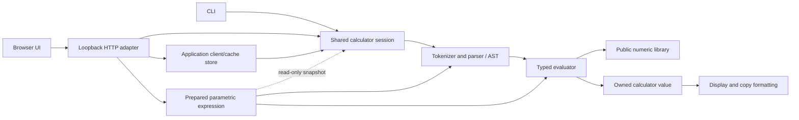

# Architecture overview

NumForge has a standalone numeric library, an optional public expression engine
and optional application clients. `NumForge::numforge` contains numeric types and
the runtime budget API. `NumForge::engine` adds the public stateless expression
API over the same parser/evaluator used by CLI/web. Sessions and HTTP remain
private application layers. See the [modular platform direction](MODULAR_ENGINE.md)
and [engine contract](../reference/ENGINE_API.md) for implemented scope and next steps.

## Numeric layers

| Layer | Representation and responsibility |
| --- | --- |
| BigInt | Signed integers with little-endian 64-bit magnitude limbs; exact integer operations, division, roots and number theory. |
| BigDecimal | An integer coefficient and signed decimal scale; exact decimal operations plus precision/rounding-aware division and higher functions. |
| BigRational | Reduced numerator/denominator BigInts; exact fractions, arithmetic and conversion to/from decimals. |
| Runtime budgets | Optional caller-owned, thread-local allocation/deadline scopes; ordinary library calls start no implicit budget. |

All public numeric types are opaque. Callers own created objects and returned
text according to each API's contract. Mutating public operations preserve the
destination on failure and support documented output/input aliasing. Exact
operations stay exact; approximate functions take precision and rounding
explicitly. Guard digits do not by themselves prove correct rounding in every
case; the [roadmap](../project/ROADMAP.md) records that remaining work.

## Client dependency flow

Arrows show the simplified call/data path. The session owns confirmed `ans`,
history and preview state; parsing and evaluation are shared by CLI/web. Exact
branches use BigRational and retain their internal value through confirmation,
history and cache. Decimal/approximate branches use BigDecimal. Formatting
projects the stored value for display without replacing it with rounded text.

The [parametric expression foundation](PARAMETRIC_EXPRESSIONS.md) owns a parsed
AST and snapshots of referenced session values. Graph sampling and future solver
adapters reuse the typed evaluator with a local parameter and one operation budget,
without modifying the source session. The [HTTP sampler](../reference/GRAPH_HTTP_API.md)
and [browser graph page](../guides/GRAPHS.md) are implemented, including bounded adaptive C refinement and automatic AST
parameter selection. Polynomial and bounded numerical solving are implemented
through C application adapters. The exact coefficient solver is public in the
numeric library; numerical interval solving remains a private application API.

The browser handles input, navigation and presentation in JavaScript. Expressions
are sent to the local C server for numerical evaluation. The server embeds the
HTML/CSS/JavaScript/image assets at build time; its installed executable does
not need Node.js, an asset directory or a database to run. It listens on loopback
and has bounded requests, cooperative resource budgets and in-memory sessions.
It is not a production public-hosting architecture.

## Source map

| Location | Role |
| --- | --- |
| `include/numforge/` | Installed public API contracts. |
| `src/engine/` | Public stateless expression handles, context and typed result adapter. |
| `src/algebra/` | Standalone exact polynomial solver shared with equation application adapters. |
| `src/bigint/`, `src/bigdecimal/`, `src/bigrational/` | Numeric implementations. |
| `src/units/` | Static unit registry and exact compatible-unit conversion over public BigRational API. |
| `src/web/unit_web.c` | Local HTTP unit catalogue and conversion adapter; borrows session values, preserves typed exact input and shares calculator budgets. |
| `src/internal/` | Private allocation boundaries and optional benchmark instrumentation. |
| `src/calculator/` | Expression engine: tokenizer, AST, typed evaluator, values and numerical formatting. |
| `src/application/` | Session ownership, variables/ans/history/replay and bounded client/cache pools. |
| `src/main.c` | Interactive CLI. |
| `src/web/` | Local server, HTTP framing and evaluation adapter. |
| `web/` | Editable English/Slovak browser assets. |
| `web/units.*` | Responsive unit-converter pages, calculator component styles and cancellable read-only conversion requests. |
| `cmake/EmbedWeb.cmake` | Generates the embedded assets in the build tree. |
| `tests/`, `benchmarks/` | Correctness checks and opt-in performance measurements. |

Benchmark diagnostics are opt-in and are not part of the public API or ordinary
release package. Phase timing and live-allocation tracking are separate probes.
Private product-tree/square experiments do not change production arithmetic.

Read [the API overview](../API.md), [BigInt design](BIGINT_DESIGN.md),
[BigDecimal design](BIGDECIMAL_DESIGN.md) and
[calculator design](CALCULATOR_DESIGN.md) for the detailed contracts and modules.

The targets enforce the boundaries: public `numforge_engine` links the numeric
library (`numforge_calculator` is its private build-tree alias),
`numforge_application` links the expression engine, and
`numforge_client` contains HTTP adapters and links the application. CLI links
the application directly. See [Application design](APPLICATION_DESIGN.md).
