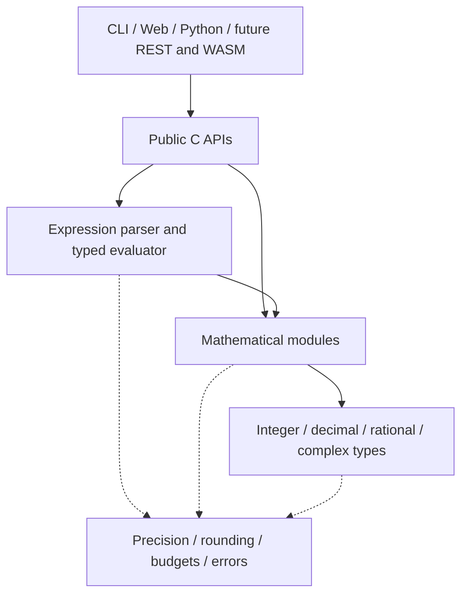

# Modular mathematics platform

Status: adopted direction, implemented incrementally. This document separates
the target architecture from the supported API in the current source tree.
It does not promise a release date or an already complete mathematics system.

## Dependency rules

- Direct mathematical calls do not require an expression parser, web server,
  session, browser, account or database.
- The expression engine calls shared mathematical implementations. Adapters
  translate input/output; they must not independently implement the algorithms.
- Session state, history, UI formatting, persistence and transport are application
  responsibilities. No numeric module depends on these layers.
- Opaque public handles hide calculator AST/value/cache details. Internal symbols
  in static archives are not a supported API; only installed header contracts are.
- A module is a responsibility and dependency boundary. Separate shared libraries,
  runtime plugin loading and a generic backend framework are not prerequisites.
- Web navigation can group operations differently from source modules.

## Module ownership

| Module | Responsibility | Current foundation / next boundary |
| --- | --- | --- |
| Core / Arithmetic | Numeric representations, elementary arithmetic and conversions | Public BigInt, BigDecimal, BigRational and complex APIs |
| Number Theory | Primality, factors, congruences and modular arithmetic | Selected public BigInt operations; broaden with individual contracts |
| Algebra | Polynomials, algebraic equations and exact root representations | Public exact linear/quadratic coefficient solver in the numeric target; application parsing/preview adapters remain private |
| Linear Algebra | Vectors, matrices, decompositions and linear systems | Public immutable dense rational matrices, exact products/determinants and unique square solves; approximate/complex domains and broader decompositions remain future |
| Calculus / Analysis | Mathematical concepts and user-facing organization | Symbolic and numerical algorithms have separate owners below |
| Numerical | Root finding, interpolation, quadrature, ODEs and optimization | Private bounded root solving; expose convergence/coverage diagnostics explicitly |
| Statistics | Datasets, aggregates, distributions, regression and tests | Public scalar aggregates/statistics; dataset API remains future work |
| Symbolic | Symbolic expression representation, assumptions and rewrites | Future; calculator AST is not automatically a public CAS representation |
| Scientific | Units, quantities, sourced constants and domain models | Public units and private quantity expressions; broader models remain future |

Numerical integration belongs to Numerical and symbolic integration to Symbolic;
both can appear under Calculus in the product. Linear systems belong to Linear
Algebra. Shared operations have one owner, even when documented in several topics.

## Common contracts

**Precision.** Distinguish working significant digits, decimal scale, display
digits and a proven error bound. Never reinterpret an existing numeric API's
scale parameter as significant digits. Working precision cannot promise the same
final accuracy after arbitrary cancellation or poorly conditioned composition.
Integer/rational arithmetic remains exact rather than rounding to a digit budget.

**Results.** Preserve typed values independently of formatted strings. Exactness
means a proven property of the computation, not simply a decimal/integer label or
cache independence. A conservative approximate classification may include a value
that happens to be mathematically exact. Certified enclosures require separate
evidence; a residual alone is not a certified root error bound.

**Failures.** Document domains, branch choices, ownership, output/input aliasing,
unchanged-output-on-failure behavior and resource exhaustion. Solver nonconvergence
and incomplete discovery are numerical outcomes, not claims that solutions do not
exist. Existing public numeric status enums remain supported; engine statuses map
them without forcing a project-wide rename.

**Runtime.** Context policy is per operation, not mutable global state. Prepared
expressions are reusable independently of the context that prepared them. A
compound operation shares one cooperative budget. Nested operations reuse an
existing scope and never reset its counters or end a caller-owned scope. Limits
are not hard process isolation. Thread-confined handles can be used independently
on separate threads; sharing requires caller synchronization.

**Adapters.** Preserve large integers and decimal inputs losslessly. Python
and future JSON adapters must not pass exact decimal input through a binary floating
point conversion. Version transport schemas separately from internal structures.
An adapter's availability is explicit; supporting a new C operation does not
require implementing every future language binding in the same change.

## Incremental milestones

1. **Current first slice:** `NumForge::engine`, installed `engine.h`, deterministic
   scalar expressions, reusable prepared ASTs, typed results, conservative
   exactness, per-operation limits and C/C++ package consumers. CLI/web retain
   their existing entry points and use the same parser/evaluator implementation.
   See [the engine contract](../reference/ENGINE_API.md).
2. **Application convergence:** explicit declared parameters and typed argument
   constructors are now public; arguments are borrowed for one evaluation only.
   Gradually use the public engine boundary where its scope fits. Design persistent
   variable binding and quantity value contracts
   before moving sessions or graph-specific prepared expressions. Do not change
   established CLI/web semantics just to match the initial public subset.
3. **Public solver slice:** exact coefficient solving is extracted into the numeric
   target as [polynomial.h](../reference/POLYNOMIAL_API.md), with no engine dependency.
   The application delegates to it. Further solver work must keep root multiplicity, exact radicals,
   approximation, domain checks and convergence/coverage diagnostics explicit.
   Validate using an installed external consumer before adapting HTTP.
4. **Python proof:** the experimental [CPython adapter](../guides/PYTHON.md) is now
   source-built over the public APIs, with lossless inputs, owned results, exceptions,
   parameters and exact polynomial descriptors. Its source/wheel installation is
   checked separately. Native calls retain the GIL; broad wheel publication and
   parallel/free-threaded execution remain separate work.
5. **New mathematics:** the first [exact matrix slice](../reference/MATRIX_API.md)
   is implemented in the numeric target and Python, with no parser dependency.
   Extend individual use cases deliberately; dataset statistics, approximate
   matrix semantics and public numerical methods remain next candidates. Make
   dependencies optional when this has a real benefit.
6. **Later:** symbolic representation/assumptions, scientific simulations, WASM
   and independently versioned public REST deployment. No new endpoint or language
   binding is implied by the architectural diagram.

## Completion criteria

The [feature checklist](../project/FEATURE_CHECKLIST.md) applies to new public
mathematical capabilities. Numeric regressions, installed consumers and existing
application behavior must pass before a boundary is considered extracted.
Reorganization alone is not a reason to rewrite proven numerical algorithms.

Doxygen comments in public headers are the source for API contracts; Markdown
guides explain mathematical meaning, workflows and supported adapters. The initial
engine header uses Doxygen syntax. Converting older headers, enabling a generated
Doxygen reference and publishing a MkDocs site are subsequent documentation tasks;
these tools are not runtime/build prerequisites for using the library.
